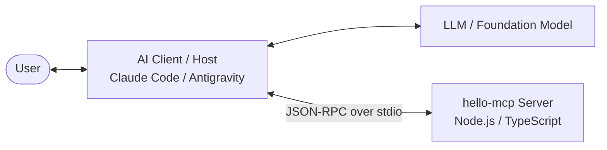
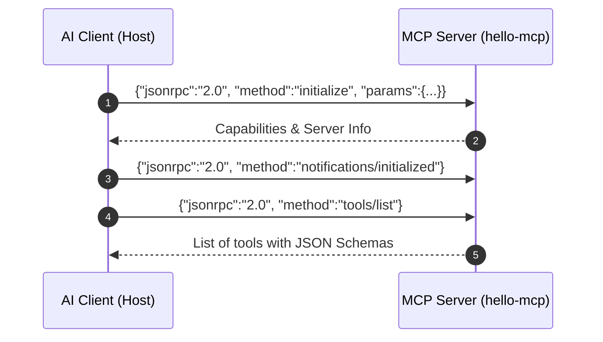
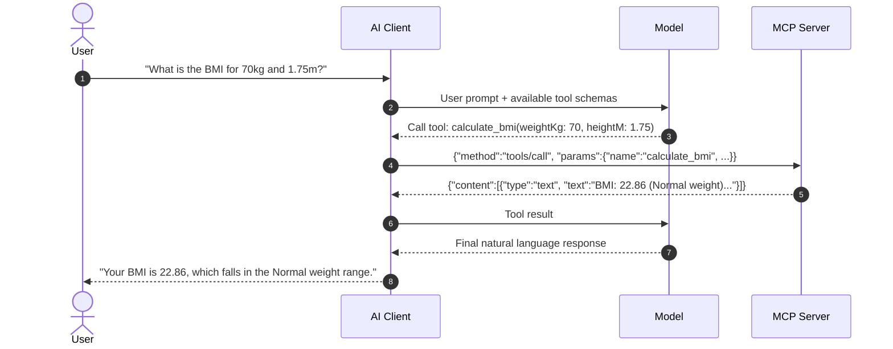

# Model Context Protocol (MCP) with Claude Code & Antigravity CLI

A complete, beginner-friendly guide and reference project for building, testing, and connecting custom **Model Context Protocol (MCP)** servers using TypeScript and Node.js.

---

## 📖 Table of Contents

- [What is Model Context Protocol (MCP)?](#what-is-model-context-protocol-mcp)
- [How MCP Works](#how-mcp-works)
  - [1. Tool Exposure](#1-tool-exposure)
  - [2. Discovery Handshake](#2-discovery-handshake)
  - [3. Tool Execution](#3-tool-execution)
- [Project Structure](#project-structure)
- [Quick Start](#quick-start)
- [Exposed Tools](#exposed-tools)
- [Testing the MCP Server](#testing-the-mcp-server)
  - [1. Direct Stdio JSON-RPC Testing](#1-direct-stdio-json-rpc-testing)
  - [2. Using with Antigravity CLI](#2-using-with-antigravity-cli)
  - [3. Using with Claude Code](#3-using-with-claude-code)
  - [4. Using the MCP Inspector](#4-using-the-mcp-inspector)
- [Critical Gotchas & Best Practices](#critical-gotchas--best-practices)
- [Adding New Tools](#adding-new-tools)

---

## What is Model Context Protocol (MCP)?

The **Model Context Protocol (MCP)** is an open standard that enables AI assistants (such as Claude Code, Antigravity CLI, or Cursor) to securely connect to external tools, databases, and APIs.

Instead of writing custom API integration code for every AI platform, MCP provides a standard protocol (over `stdio` or HTTP) using JSON-RPC 2.0. An MCP server can expose:
- **Tools**: Callable functions with structured inputs that the LLM can execute.
- **Resources**: Read-only data or files that the LLM can view.
- **Prompts**: Pre-configured prompt templates for recurring tasks.

---

## How MCP Works



### 1. Tool Exposure
Tools are defined using `@modelcontextprotocol/sdk` and `zod`. Each tool provides:
1. **Name**: Unique identifier (e.g., `say_hello`).
2. **Description**: Natural language description that guides the model on when to select the tool.
3. **Input Schema**: Zod object that automatically converts to standard JSON Schema.
4. **Handler**: An asynchronous function that receives validated arguments and returns formatted content.

### 2. Discovery Handshake
When the client launches the MCP server process:
1. **`initialize`**: The client and server negotiate protocol versions and advertise capabilities.
2. **`notifications/initialized`**: The client signals it is ready.
3. **`tools/list`**: The client queries available tools. The server responds with tool names, descriptions, and JSON Schemas.
4. **Context Injection**: The client adds these tool definitions to the LLM's system prompt.



### 3. Tool Execution
When a user asks a question that requires a tool:
1. The LLM produces a structured function call matching the tool schema.
2. The client sends a `tools/call` JSON-RPC message over standard input (`stdin`).
3. The MCP server executes the corresponding TypeScript handler.
4. The server returns the result over standard output (`stdout`).
5. The client passes the result back to the LLM to synthesize the final answer for the user.



---

## Project Structure

```
mcp-with-claude-code/
├── .gitignore               # Ignored files (node_modules, dist, logs, etc.)
├── README.md                # Project documentation
└── hello-mcp/               # MCP server package
    ├── package.json         # NPM package configuration & scripts
    ├── tsconfig.json        # TypeScript compiler options
    ├── src/
    │   └── index.ts         # MCP Server source code & tool implementations
    └── dist/                # Compiled JavaScript output (generated after build)
```

---

## Quick Start

### 1. Prerequisites
- **Node.js**: Version 18.0.0 or higher (`node -v`)
- **npm**: Version 9.0.0 or higher (`npm -v`)

### 2. Installation
Navigate into the `hello-mcp` folder and install dependencies:
```bash
cd hello-mcp
npm install
```

### 3. Build the Project
Compile TypeScript into JavaScript:
```bash
npm run build
```
This produces the executable server in `hello-mcp/dist/index.js`.

### 4. Development Mode (Live Execution)
To run directly with `tsx` without pre-building:
```bash
npm run dev
```

---

## Exposed Tools

| Tool Name | Description | Parameters | Example Output |
| :--- | :--- | :--- | :--- |
| `say_hello` | Generates greetings in multiple languages. | `name` (string, required)<br/>`language` (`"en" \| "es" \| "fr" \| "de" \| "ja"`, optional) | `"Bonjour, Alex! Bienvenue dans le Model Context Protocol."` |
| `calculate_bmi` | Calculates Body Mass Index and category. | `weightKg` (number, positive)<br/>`heightM` (number, positive) | `"BMI: 22.86 (Normal weight) for weight=70kg, height=1.75m"` |

---

## Testing the MCP Server

### 1. Direct Stdio JSON-RPC Testing
You can verify the server directly from the command line by piping JSON-RPC messages into `node dist/index.js`:

```bash
printf '{"jsonrpc":"2.0","id":1,"method":"initialize","params":{"protocolVersion":"2024-11-05","capabilities":{},"clientInfo":{"name":"test-client","version":"1.0.0"}}}\n{"jsonrpc":"2.0","method":"notifications/initialized"}\n{"jsonrpc":"2.0","id":2,"method":"tools/call","params":{"name":"say_hello","arguments":{"name":"Alex","language":"es"}}}\n' | node dist/index.js
```

**Expected Response**:
```json
{"result":{"content":[{"type":"text","text":"¡Hola, Alex! Bienvenido al Model Context Protocol."}]},"jsonrpc":"2.0","id":2}
```

### 2. Using with Antigravity CLI
Add your server configuration to your global Antigravity config file at `~/.gemini/config/mcp_config.json`:

```json
{
  "mcpServers": {
    "hello-mcp": {
      "command": "node",
      "args": ["/workspaces/mcp-with-claude-code/hello-mcp/dist/index.js"]
    }
  }
}
```

Once configured, the Antigravity agent will discover `say_hello` and `calculate_bmi` automatically in every session.

### 3. Using with Claude Code
Register the MCP server with Claude Code using the CLI:

```bash
claude mcp add hello-mcp node /workspaces/mcp-with-claude-code/hello-mcp/dist/index.js
```

Or add it to your project-level `.mcp.json`:
```json
{
  "mcpServers": {
    "hello-mcp": {
      "command": "node",
      "args": ["/workspaces/mcp-with-claude-code/hello-mcp/dist/index.js"]
    }
  }
}
```

### 4. Using the MCP Inspector
Anthropic provides an interactive visual debugger:

#### In GitHub Codespaces (Web UI)
To prevent DNS rebinding 403 errors and line-wrapping issues, use the provided helper script:
```bash
./run-inspector.sh
```
Or run `npm run inspect` inside `hello-mcp/`. This automatically exports all required origins and launches the Inspector on port 6274.
Open the forwarded browser URL to inspect tools and run tests visually.

#### In Terminal (CLI Mode - No Browser Required)
You can also run the inspector directly inside the terminal without dealing with browser ports:
```bash
# List tools
npx @modelcontextprotocol/inspector --cli node hello-mcp/dist/index.js --method tools/list

# Call a tool
npx @modelcontextprotocol/inspector --cli node hello-mcp/dist/index.js --method tools/call --tool-name say_hello --tool-args-json '{"name":"Alex","language":"es"}'
```

---

## Critical Gotchas & Best Practices

> [!WARNING]
> **Never log with `console.log()` in a stdio MCP server!**
> Stdio communication relies entirely on `stdout` being strictly reserved for valid JSON-RPC lines. Any plain-text log from `console.log()` will corrupt the stream and crash client parsing.
> 
> **Always use `console.error()`** for internal diagnostic logs, as `stderr` is ignored by the JSON-RPC parser.

> [!TIP]
> **Descriptive Schemas Guide the LLM**:
> Use `.describe(...)` on all Zod fields. LLMs rely on these descriptions to know which values to pass and in what units (e.g., `weightKg: z.number().describe("Weight in kilograms")`).

---

## Adding New Tools

To expose a new tool, open `hello-mcp/src/index.ts` and call `server.tool()`:

```typescript
server.tool(
  "convert_temperature",
  "Convert temperature between Celsius and Fahrenheit",
  {
    value: z.number().describe("Temperature value to convert"),
    from: z.enum(["C", "F"]).describe("Source unit: C for Celsius, F for Fahrenheit"),
  },
  async ({ value, from }) => {
    let converted: number;
    let targetUnit: string;

    if (from === "C") {
      converted = (value * 9) / 5 + 32;
      targetUnit = "°F";
    } else {
      converted = ((value - 32) * 5) / 9;
      targetUnit = "°C";
    }

    return {
      content: [
        {
          type: "text",
          text: `${value}°${from} = ${converted.toFixed(2)}${targetUnit}`,
        },
      ],
    };
  }
);
```

Rebuild the project with `npm run build` and restart your client to use the new tool immediately!